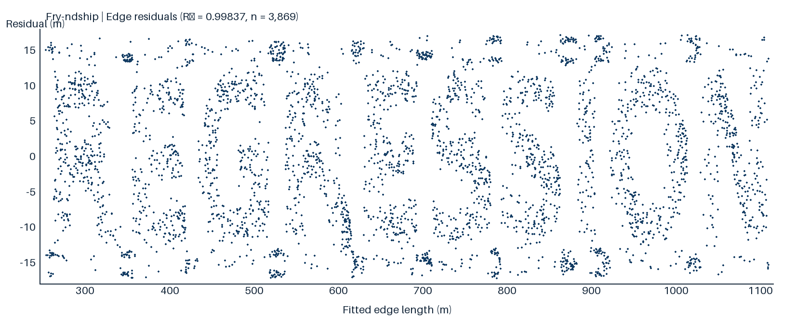

# Fry-ndship

**Flag** `SIGMOID_REGRESSION`

Convert hectares to square metres and estimate the short side as area divided by the declared long side. For each field, the rectangular perimeter is `P = 2 * (long_side_m + 10000 * area_ha / long_side_m)`.

Fit ordinary least squares with an intercept to the 3,869 measured edges. The fitted equation is `edge_m = -0.000441 + 0.94999923 * P`, with in-sample R² of 0.99836730. Plot measured minus fitted edge length against fitted edge length. From left to right, the points spell **REGRESSION**.



Download [potato_fields.csv](https://drive.google.com/file/d/1VmYoc4Ltg5EDyx0zt3kFdAt8P04Bbuj2/view). With Python and Pillow 10.1 or newer, run:

```sh
python fry_ndship/solve.py path/to/potato_fields.csv
```
