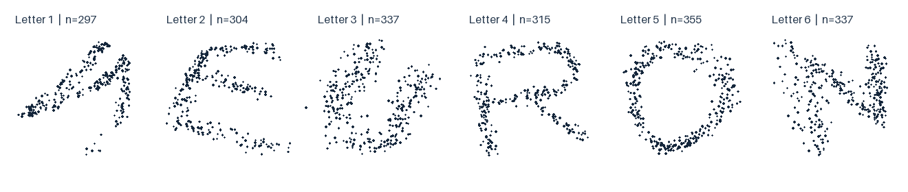

# Point par point

**Flag** `SIGMOID_NEURON`



I matched the challenge listings against the [September 2026 Inside Airbnb Paris snapshot](https://data.insideairbnb.com/france/ile-de-france/paris/2026-09-16/visualisations/listings.csv). I rounded the reference coordinates to five decimal places and joined on latitude, longitude, total review count and availability. Of the 28,108 challenge rows, 1,946 had no match. The locations of these candidates trace overlapping strokes across Paris.

I standardized longitude, latitude, price and availability among the unmatched rows and ran DBSCAN with eps 0.45 and min_samples 5. It found six clusters and one noise point. The two leading principal components of each cluster show the letter shapes. The rotations and reflections in the script were selected by visual inspection to make the glyphs upright. These display adjustments do not affect the labels.

Sorting by mean nightly price yields N, E, U, R, O, N, with means of approximately 102, 134, 186, 252, 334 and 483 EUR. The corresponding cluster sizes are 297, 304, 337, 315, 355 and 337.

`labels.csv` contains one row per challenge listing, in input order. The six glyphs are labeled 0 through 5. Background listings and the DBSCAN noise point are labeled -1.

To reproduce both outputs, download [the challenge CSV](https://drive.google.com/file/d/1IrbgRIZhyvdVR_RsOzy6T71hKZitaXd9/view) and run:

```sh
python -m pip install -r requirements.txt
python solve.py /path/to/paris_listings.csv
```

The script downloads the reference snapshot by default. Use `--reference /path/to/listings.csv` for a local copy.
